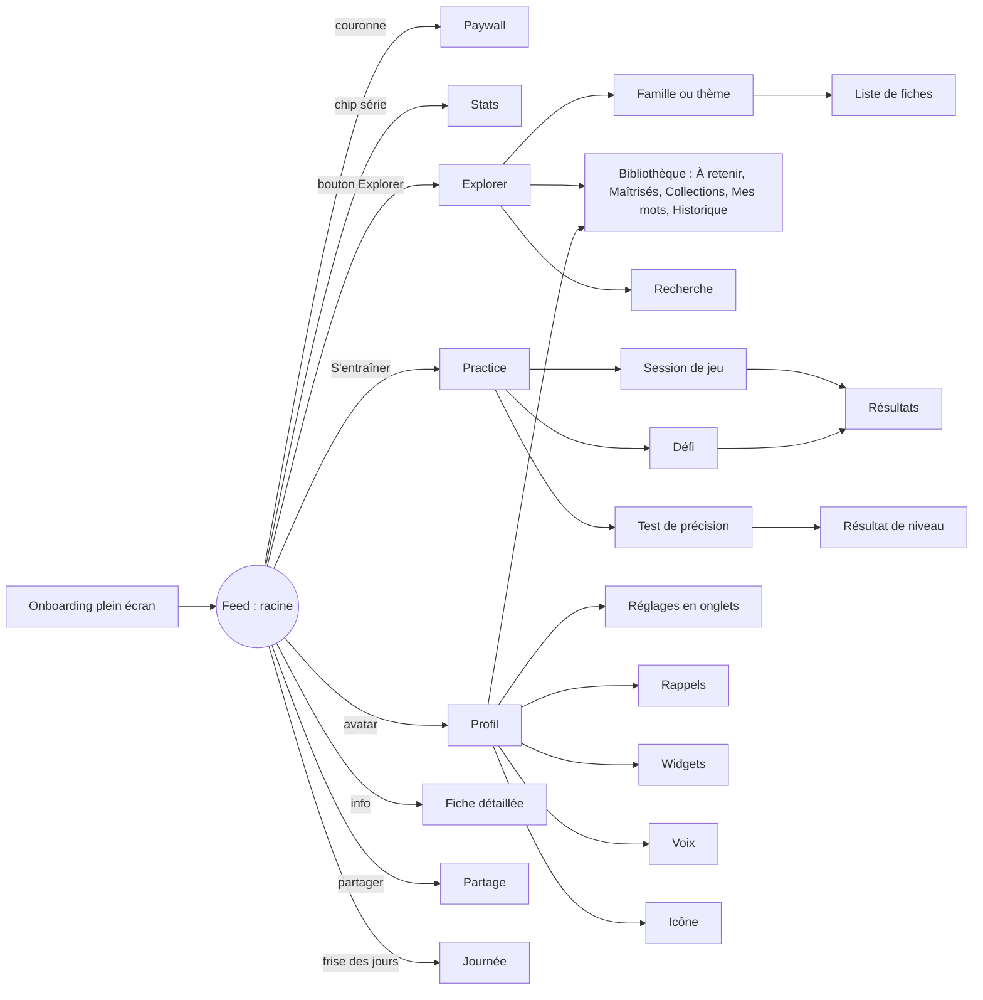

# 01 Écrans

Chaque écran : identifiant, rôle, présentation, contenu de haut en bas, actions, états, textes français. Composants et tokens : `02_DESIGN_SYSTEM.md`. "Réf. Vocabulary" renvoie à la capture de structure dans `~/Documents/Hugo's/Cortex SASU/Produits/Words/Vocabulary Rebuild/Screens/` (le visuel ne doit pas être copié, seulement la structure).

Conventions :
- **Sheet** = sheet flottante (12 pt des bords, rayon 44), poignée en haut, fermeture par glissement ou bouton rond `xmark`.
- **Onglets bas** = barre de pilules en bas de sheet (style Sudoku a Day).
- Tous les textes sont dans `Localizable.xcstrings`. Les textes ci dessous sont la version française de référence.

## Carte de navigation

---

## A. Onboarding (plein écran, linéaire, barre de progression fine en haut, retour possible sauf après le paywall)

Réf. Vocabulary : `A Onboarding` 01 à 24 (21 écrans). Sagace en garde 10, met la valeur (mini test) **avant** le paywall et retire genre, icône, thème et upsell.

### ONB-01 Bienvenue
- Illustration `ill_onb_splash`.
- Titre `hero` : **Le mot juste, chaque jour.**
- Texte : *Quelques minutes par jour pour parler et écrire avec précision. Sans jargon, sans mots pédants.*
- Bouton principal : **Commencer**.

### ONB-02 Attribution
- Titre : **Comment avez-vous connu Sagace ?**
- Options (sélection unique, passe à l'écran suivant au toucher) : TikTok, Instagram, Facebook, YouTube, App Store, Recherche web, Un proche, Autre.
- Lien discret en bas : **Passer**.
- Donnée : `UserProfile.attribution`.

### ONB-03 Âge
- Titre : **Quel âge avez-vous ?** Sous titre : *Pour adapter les exemples à votre quotidien.*
- Options : 13 à 17, 18 à 24, 25 à 34, 35 à 44, 45 à 54, 55 ans et plus. Lien **Passer**.

### ONB-04 Objectifs
- Titre : **Qu'aimeriez-vous améliorer ?** Sous titre : *Plusieurs choix possibles.*
- Options multi sélection : Écrire au travail · Parler avec assurance · Réussir un examen ou un concours · Aider mes enfants · Par curiosité.
- Bouton **Continuer**, désactivé tant que rien n'est choisi.
- Effet : pondère les thèmes du feed (Écrire au travail → thème Travail ×1,5, etc. : table dans `03_ARCHITECTURE.md`).

### ONB-05 Intro du mini test
- Illustration `ill_onb_test`.
- Titre : **Petit test : 5 pièges du quotidien.**
- Texte : *Une minute, pour savoir par où commencer.*
- Bouton : **C'est parti**.

### ONB-06 Mini test (5 questions)
- Composant `QuestionCard` + 3 `AnswerRow`, passage automatique après 0,8 s.
- 5 questions tirées des familles Paronymes, Impropriétés, Passe partout, Nuances, Pléonasmes (une par famille, niveau intermédiaire).
- Exemple de question : *« Le départ est ___ : les valises sont dans l'entrée. »* → imminent · éminent · immanent.

### ONB-07 Résultat du mini test
- Grand score `metricValue` : **3 / 5**
- Phrase selon le score : 5 : *Impressionnant. On va viser les pièges plus fins.* · 3 à 4 : *Bien vu. Quelques pièges vous ont échappé, c'est exactement ce qu'on va travailler.* · 0 à 2 : *C'est normal : ces pièges trompent la plupart des gens. Vous allez vite progresser.*
- Liste des 5 questions avec bonne réponse en une ligne.
- Bouton **Continuer**. Effet : niveau de départ (0 à 2 : Débutant, 3 : Intermédiaire, 4 : Avancé, 5 : Expert).

### ONB-08 Rythme
- Titre : **Combien de fiches par jour ?**
- Options : **3 fiches** · *Tranquille, 1 minute* / **5 fiches** · *Régulier, 3 minutes* (présélectionné) / **10 fiches** · *Intensif, 6 minutes* (badge PRO, choisissable pendant l'essai).
- Donnée : `Preferences.dailyGoal`.

### ONB-09 Notifications
- Titre : **Une fiche au bon moment.**
- Aperçu d'une vraie notification : *Sagace · éminent ou imminent ? Le départ est imminent, l'invité est éminent.*
- Choix de l'heure : sélecteur **9:00** par défaut, et toggle *Un rappel le soir si la série est en danger* (activé).
- Bouton **Activer les notifications** → alerte système. Lien **Plus tard**.

### ONB-10 Paywall d'onboarding
Voir `PAY-01`. Fermable (bouton `xmark` visible dès l'arrivée).

### ONB-11 Widget
- Illustration `ill_onb_widget` ou animation du geste.
- Titre : **Une fiche sur votre écran d'accueil.**
- Texte : *Touchez longuement l'écran d'accueil, puis Modifier, puis Ajouter un widget, et cherchez Sagace.*
- Boutons : **Installer le widget** (affiche les instructions pas à pas) · **Plus tard**.

### ONB-12 Tuto de glisse
- Le feed apparaît avec une première fiche et un coachmark : *Glissez vers le haut pour la fiche suivante.* Puis, sur la fiche : *Triez : je savais, ou à retenir.*

---

## B. Feed (racine permanente)

Réf. Vocabulary : `B Feed` 01 à 10. Habillage : carte du jour de Sudoku a Day.

### FEED-01 Feed, état normal
De haut en bas :
1. **Barre du haut** : bouton rond bleu couronne (masqué si premium) · chip série (icône laurier + nombre de jours) · espace · bouton rond Explorer (`square.grid.2x2`) · avatar rond `#D1ADA8` avec l'initiale du prénom (ou icône personne).
2. **Carte fiche** (`FicheCard`), pleine largeur moins 48 pt, environ 62 % de la hauteur :
   - Libellé fantôme : la famille (*Paronymes*), en `heroGhost`.
   - Mot en `hero` : **éminent**.
   - Ligne meta : nature et genre (*adj.*), phonétique `/e.mi.nɑ̃/`, bouton haut parleur.
   - Définition courte (17 pt) : *Qui s'élève au dessus des autres par son mérite ou son rang.*
   - Bloc "À ne pas confondre" (si `confusions`) : chip **imminent** → *qui va arriver très bientôt*.
   - Bloc usage (si `usage`) : deux lignes, icône check vert *On dit : pallier un manque* et icône croix rouge *On évite : pallier à un manque*, avec le verdict (*critiqué*, *fautif*, *toléré*) en petite capsule.
   - Phrase d'auteur en italique, 15 pt, `textSecondary`, puis *Victor Hugo, Les Misérables (1862)*.
   - Pilule bas de carte : **S'entraîner** (ouvre Practice).
3. **Barre d'actions** (4 boutons ronds `surfaceRaised`, 52 pt) : info (fiche détaillée) · partager · **Je savais** (`checkmark`) · **À retenir** (`bookmark`).
4. **Frise des jours** (7 jours, lun à dim) : jour, chiffre, anneau de progression de l'objectif. Jour courant en `surfaceSelected`. Après le dernier lot du jour : *Prochain lot dans 6 h* en grisé.

Gestes et règles :
- Glisser vers le haut : fiche suivante (pagination verticale). Vers le bas : précédente.
- **Je savais** : la fiche est marquée connue, ne revient plus, anneau +1, haptique `.light`, passage automatique à la suivante après 0,3 s.
- **À retenir** : la fiche entre en révision (boîte 1), anneau +1, bookmark rempli, haptique `.light`, passage automatique.
- Une fiche simplement glissée sans tri ne compte pas dans l'anneau.
- Toutes les 5 fiches, si une révision est due : `FEED-02`.
- Objectif atteint : `FEED-04`.

### FEED-02 Carte de révision (dans le feed)
- Même carte, libellé fantôme **Révision**, badge du nombre de jours depuis le tri (*Vu il y a 3 jours*).
- Une question générée (`QuestionFactory`, type adapté à la famille), 3 `AnswerRow`.
- Juste : vert, haptique `.success`, boîte +1, texte *Bien retenu. Prochaine révision dans 7 jours.* Faux : rouge, la bonne réponse s'affiche, boîte remise à 1.
- Passage à la fiche suivante par glisse.

### FEED-03 Mot maîtrisé
- Quand une révision réussit en boîte 4 (21 jours) : sheet basse façon "Game Over" inversé, illustration `ill_result_good`, titre **Maîtrisé : éminent**, texte *Vous avez maîtrisé 23 mots.*, bouton **Continuer**. Haptique `.success` puis `.light`.

### FEED-04 Objectif du jour atteint
- L'anneau du jour se ferme, toast en haut : **Objectif atteint · 5 fiches · Série : 12 jours**. Haptique `.success`.
- Une fois par jour : sheet proposant **Un jeu de 2 minutes ?** avec les 3 jeux suggérés (le plus faible du profil d'abord), bouton **Plus tard**.
- Les fiches suivantes restent accessibles (gratuit : jusqu'à 2 fois l'objectif ; premium : sans limite) ; au delà, carte de fin : *C'est tout pour aujourd'hui. Prochain lot dans 6 h.* + bouton **Débloquer plus de fiches** (paywall) pour les gratuits.

### FEED-05 Coachmarks (une seule fois chacun)
- Glisser vers le haut. Trier. Ouvrir la fiche détaillée (*Touchez i pour les nuances et les sources*). Le widget, au 3e jour.

### FEED-06 Journée (toucher la frise)
- Sheet : date en `hero`, anneau, liste des fiches du jour avec leur tri, bouton **Revoir ces fiches**.

---

## C. Fiche détaillée et partage

Réf. Vocabulary : `B Feed` 15, 16, 17.

### DET-01 Fiche détaillée (sheet, gratuite en entier)
De haut en bas : mot `hero`, phonétique et haut parleur, nature et genre, registre (capsule).
Sections (titres `caps`) :
1. **Sens** : définition complète.
2. **À ne pas confondre** : chaque confusion avec son sens et une phrase.
3. **Bon usage** : On dit / On évite, verdict expliqué en une phrase (*Critiqué par l'Académie, mais courant à l'oral.*).
4. **Nuance** : texte court tiré du Littré ou de Lafaye, reformulé.
5. **Exemples** : 2 phrases modernes, le mot en gras.
6. **Chez les auteurs** : la phrase d'auteur, auteur, œuvre, année, lien Wikisource.
7. **Synonymes** : chips (toucher = ouvrir la fiche si elle existe).
8. **Étymologie** : une ligne.
9. **Sources** : *Wiktionnaire, Littré, Lexique 3* avec liens. Bouton **Signaler une erreur**.
Barre basse : partager · ajouter à une collection · Je savais · À retenir.

### DET-02 Signaler une erreur
- Sheet : choix (Définition inexacte · Exemple maladroit · Faute dans le texte · Autre), champ libre optionnel, **Envoyer**. Toast *Merci, on corrige sous 7 jours.*

### SHR-01 Partage
- Aperçu de la carte image (fiche en carte `surface`, logo Sagace discret en bas, apparence clair ou sombre au choix).
- Actions : Clair / Sombre · Enregistrer l'image · Copier le texte · Messages · Partager…
- Le texte copié : *éminent ≠ imminent. Éminent : qui s'élève au dessus des autres. Imminent : qui va arriver très bientôt. Via Sagace.*

---

## D. Explorer (sheet, depuis le bouton grille)

Réf. Vocabulary : `B Feed` 18 à 49.

### EXP-01 Explorer
- Titre `sheetTitle` : **Explorer**. Bouton **Modifier** (choix des familles et thèmes suivis).
- Bloc **Bibliothèque** (grille 2 × 3 de tuiles `surfaceRaised`) : À retenir (n) · Maîtrisés (n) · Collections · Mes mots · Historique · Signalés.
- Section **Familles** : 8 tuiles illustrées (une par famille), check si suivie, cadenas PRO si filtre réservé.
- Section **Thèmes** : Travail · Émotions · Relations · Société · Argent · Santé · Droit · Sciences et tech · Culture · Cuisine · Voyage · Nature.
- Barre de recherche flottante en bas : *Chercher un mot*.
- Gratuit : toutes les tuiles sont visibles, ouvrir une famille ou un thème montre 3 fiches puis le bandeau violet PRO.

### EXP-02 Famille ou thème
- Titre, illustration, phrase d'intro (*Deux mots qui se ressemblent, deux sens différents.*), boutons **Suivre** (filtre le feed) et **S'entraîner sur cette famille**.
- Liste de `FicheRow` (mot, définition courte, statut : nouveau, à retenir, maîtrisé).

### EXP-03 Recherche
- Résultats en direct parmi les fiches (mot, confusions, synonymes). Vide : *Aucune fiche pour « xxx ». Proposer ce mot ?* (envoie une suggestion).

### LIB-01 À retenir
- Liste triée par prochaine révision (*Révision demain*, *dans 6 jours*). Bouton **Réviser maintenant** (session de 10 questions sur ces fiches).
### LIB-02 Maîtrisés
- Grand compteur en tête, liste par date de maîtrise.
### LIB-03 Collections
- Vide : illustration `ill_empty_collections`, *Regroupez vos fiches, par exemple « Réunions » ou « Mémoire de fin d'études ».*, bouton **Créer une collection**. Collections suggérées : Écrire au travail · Pièges des mails · Bac de français.
- Détail : liste, **Suivre dans le feed**, **S'entraîner**, tri, renommer, supprimer.
### LIB-04 Mes mots
- Vide : `ill_empty_ownwords`, *Ajoutez un mot qui vous pose problème.* Formulaire : Mot · Définition · Nature (Nom, Verbe, Adjectif, Adverbe, Expression) · Genre si nom. **Ajouter**. Erreur : *Au moins un caractère.*
### LIB-05 Historique
- Fiches vues, groupées par jour, avec leur tri. **Voir plus ancien**.

---

## E. Practice (sheet, depuis "S'entraîner")

Réf. Vocabulary : `C Practice` 02 à 40. Habillage : sélecteur de difficulté et "Game Over" de Sudoku a Day.

### PRA-01 Hub
- Titre **S'entraîner**. Carte niveau : *Votre niveau : Intermédiaire* (couleur du niveau), **Repasser le test**, ou *Testez votre précision* si jamais fait.
- Section **Jeux** (grille 2 × 3) : Le mot juste · Paronymes · Juste ou fautif · Passe partout · Sens · Devine le mot. Badge *Suggéré* sur le jeu de la compétence la plus faible.
- Section **Défis** (3 tuiles) : Rush · Sprint · Perfection.
- Section **Par famille** : liste des familles suivies.
- Gratuit : 1 session par jour (compteur *1 session gratuite aujourd'hui*), défis et suivantes derrière le bandeau PRO.

### PRA-02 Question (tous jeux)
- En haut : barre de progression segmentée (10), bouton `xmark`, libellé du jeu en fantôme.
- `QuestionCard` puis 3 `AnswerRow` (Juste ou fautif : 2 boutons larges **Juste** / **Fautif**, et glisse droite ou gauche).
- Après réponse : `FeedbackSheet` basse.
  - Juste : icône check, **Exact.**, rappel de la règle en une ligne, **Suivant**.
  - Faux : icône croix, **Pas tout à fait.**, bonne réponse, explication en une phrase, **Suivant**.

Jeux (règles détaillées dans `03_ARCHITECTURE.md` section 7) :
| Jeu | Question | Réponses |
| -- | -- | -- |
| Le mot juste | une phrase avec un blanc | 3 mots voisins, un seul exact |
| Paronymes | une phrase avec un blanc | les 2 ou 3 paronymes |
| Juste ou fautif | une phrase complète | Juste / Fautif, puis la correction |
| Passe partout | une phrase avec "faire", "mettre"… souligné | 3 verbes précis |
| Sens | un mot | 3 définitions |
| Devine le mot | une définition | 3 mots |

### PRA-03 Résultats de session
- Score `metricValue` : **8 / 10**, phrase selon le score, ligne de 5 cercles (sessions sur les 5 derniers jours).
- Liste des réponses (fiche, juste ou faux, bouton À retenir).
- Boutons : **Rejouer** · **Terminer**. Haptique `.success`.

### PRA-04 Défi Rush
- Intro : `ill_challenge_rush`, *Répondez au plus vite. 5 secondes par question, 3 vies.* **Commencer**.
- Jeu : barre de temps, 3 cœurs, compteur de questions.
- Fin : sheet **Plus de vies !** *12 bonnes réponses sur 15.* Record personnel. **Rejouer** (bleu) · **Terminer**.

### PRA-05 Défi Sprint
- 60 secondes au total, erreurs sans vie, score = bonnes réponses. Fin : **Temps écoulé !**

### PRA-06 Défi Perfection
- Sans limite de temps, fin à la première erreur, score = série. Fin : **Série terminée à 9.**

### PRA-07 Test de précision
- Intro : `ill_onb_test`, *30 questions, environ 5 minutes. Pour mesurer votre précision et adapter vos fiches.* **Commencer**.
- 30 questions, 6 par niveau de difficulté, toutes familles, passage automatique.

### PRA-08 Résultat de niveau
- Les 5 lignes de niveau à la Sudoku a Day : Débutant (gris) · Élémentaire (violet) · Intermédiaire (rouge) · Avancé (bronze) · Expert (inversé). La ligne de l'utilisateur dépliée avec sa description et un check.
- *Score : 16 / 30 · 3 points avant Avancé.*
- **Voir mes réponses** · **Terminer**.

---

## F. Stats (sheet, depuis la chip série) : onglets bas **Série · Progrès · Succès**

Réf. Vocabulary : `C Practice` 31 à 35, et "Stats" / "Streak" de Sudoku a Day.

### STA-01 Série
- Série actuelle · Record · Jours parfaits (objectif atteint).
- Calendrier du mois en cercles (plein = objectif atteint, contour = activité partielle).
### STA-02 Progrès
- Chips de filtre : Tout · par famille.
- Carte 2 × 2 : Fiches vues · À retenir · **Maîtrisées** · Sessions.
- Précision sur 14 jours par compétence (Sens, Usage, Choix du mot) en barres horizontales.
- Gratuit : Série complète, Progrès flouté avec bandeau PRO.
### STA-03 Succès
- Badges simples : 7 jours de série, 50 maîtrisés, 100 % à un test, toutes les familles explorées… (liste dans `03_ARCHITECTURE.md`).

---

## G. Profil (sheet, depuis l'avatar)

Réf. Vocabulary : `D Profil` 01 à 05 ; structure Sudoku a Day (carte violette, carte premium, liste).

### PRO-01 Profil
1. Carte violette **Soutenez une app indépendante** : *Sagace est faite à Paris, sans pub. Une note ou un partage nous aide beaucoup.* Boutons **Noter** · **Partager**.
2. Carte premium (si gratuit) : *Sagace Premium : jeux illimités, toutes les familles, stats, widgets.* **Essayer gratuitement**. Si premium : *Membre Premium* et date de renouvellement.
3. Liste : Rappels · Widgets · Voix · Apparence · Icône de l'app · Réglages · Envoyer un avis · À propos.

### SET-01 Réglages (onglets bas : Contenu · Jeu · Effets · Notifications · Compte)
- **Contenu** : Rythme (3, 5, 10) · Niveau (affiche le résultat, **Repasser le test**) · Familles et thèmes suivis · Afficher les expressions familières (toggle) · Mots masqués.
- **Jeu** : Passage automatique après réponse (toggle) · Afficher la règle après chaque réponse (toggle).
- **Effets** : Sons (Muet · Effets · Effets et ambiance, sélecteur rond) · Retour haptique (toggle) · Animations (toggle).
- **Notifications** : raccourci vers Rappels, rappel du soir si série en danger (toggle).
- **Compte** : Gérer l'abonnement · Restaurer les achats · Identifiant utilisateur (copiable) · Confidentialité · Conditions.

### REM-01 Rappels
- Liste des rappels (gratuit : 1, premium : illimité, bandeau PRO sinon).
- Édition : Source (Fiches du jour · À retenir · Une collection · Une famille) · Nombre par jour (1 à 10) · Entre 9:00 et 21:00 (pas de 30 min) · Jours (L M M J V S D) · Son. **Enregistrer** · **Supprimer**.

### WID-01 Widgets
- Explication en 3 étapes avec aperçu. Configurations : Fiche du jour (petit, moyen, grand) · Révision (moyen, interactif) · Série (petit) · Écran verrouillé.
- Configuration (premium pour plusieurs) : Familles · Rafraîchissement (Toutes les heures · 2 fois par jour · 1 fois par jour) · Afficher la phrase d'auteur (grand uniquement).

### VOI-01 Voix
- Liste des voix françaises disponibles sur l'appareil (fr-FR, fr-CA, qualité Améliorée en premier), bouton écouter, check. Gratuit : 1 voix, PRO pour les autres. Lien : *Télécharger des voix de meilleure qualité dans Réglages iOS.*

### APP-01 Apparence
- Automatique · Clair · Sombre (lignes avec aperçu).

### ICO-01 Icône de l'app
- Grille des icônes alternatives Sagace (6), check sur l'actuelle.

---

## H. Paywall

Réf. structure : paywall de Sudoku a Day (`design/SAD 04 paywall.jpg`) et frise d'essai Vocabulary 2026 (`A Onboarding` 26, 27).

### PAY-01 Paywall
De haut en bas :
1. Bouton `xmark` (visible immédiatement).
2. Illustration `ill_paywall`.
3. Ligne tag bleue : **Fait à Paris, sans publicité**.
4. Titre `title` : **Le mot juste, sans limite.**
5. Texte : *Sagace est une petite app indépendante. Avec Premium, vous débloquez tous les jeux, toutes les familles de fiches, les stats et les widgets, et vous nous aidez à écrire de nouvelles fiches chaque mois.*
6. Liste de 4 avantages avec icônes : Jeux et défis illimités · Toutes les familles et thèmes · Stats et mots maîtrisés · Widgets et rappels personnalisés.
7. Plans (lignes, sélection à contour bleu) : **Annuel** · *3 jours gratuits, puis 29,99 € par an* (sélectionné, badge *Le plus choisi*) / **À vie** · *49,99 €, une seule fois*.
8. Frise d'essai si Annuel : Aujourd'hui *Accès complet* · Jour 2 *Rappel avant la fin de l'essai* · Jour 3 *Début de l'abonnement, annulable à tout moment*.
9. Toggle **Me rappeler avant la fin de l'essai**, activé par défaut.
10. Bouton bleu : **Commencer l'essai gratuit** (ou **Acheter** pour À vie).
11. Pied : Restaurer · Conditions · Confidentialité · *Partage familial inclus*.

Points d'entrée (`PaywallSource`) : onboarding, couronne, bandeau PRO, fin de lot gratuit, fiche verrouillée en famille, stats, rappels, voix, widgets.

### PAY-02 Offre de bienvenue
- Si l'utilisateur a fermé le paywall d'onboarding, à la 3e ouverture de l'app : même paywall avec *Offre de bienvenue : 40 % sur la première année* (offre promotionnelle StoreKit), une seule fois.

---

## I. États transverses
- **Hors ligne** : tout fonctionne (contenu embarqué), seules les sources externes (liens) sont inactives.
- **Erreur d'achat** : alerte *L'achat n'a pas abouti. Aucun montant n'a été débité.*
- **Mise à jour depuis Words v3** : écran unique `MIG-01` au premier lancement, voir `04_MIGRATION.md`.
